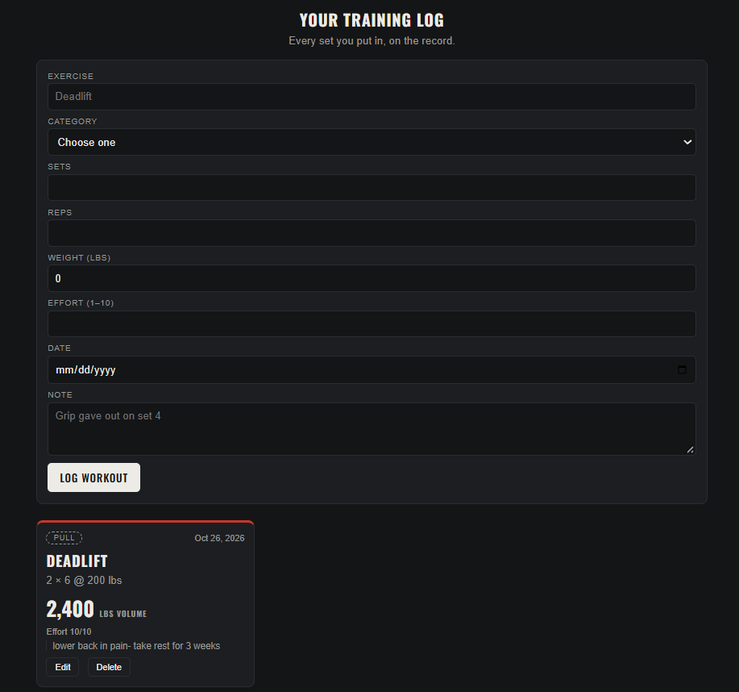

# Workout Log

**Live site: https://workout-log-ismail.onrender.com**

A training log that keeps every set on the record. Sign up, log in, and log your workouts: exercise, category, sets, reps, weight, effort, and a short note if you want one.

## What it does

- Log a workout with exercise, category (Push, Pull, Legs, Core, Conditioning), sets, reps, weight in lbs, effort from 1 to 10, date, and an optional note
- Every entry shows its volume, sets x reps x weight, worked out for you
- A stats strip at the top keeps count of your sessions and your total volume
- Edit or delete any of your entries
- Your log is private: every workout is stamped with your account, and the app only ever loads your own

## Built with

- Node.js and Express
- MongoDB Atlas with Mongoose. The Workout model carries the rules, so a bad entry (51 sets, an effort of 42) gets rejected before it ever reaches the database
- Passport for sign up and login
- EJS pages and my own CSS, dark iron theme

## How to run it

1. Clone the repo and run `npm install`
2. Create a `.env` file with `DB_STRING` (your MongoDB Atlas connection string) and `SESSION_SECRET` (any long phrase)
3. Run `node server.js`
4. Open http://localhost:8030

The Workout-Log database creates itself the first time a workout is saved.
